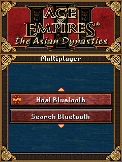
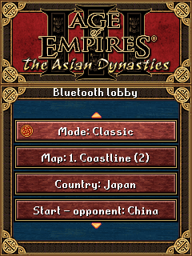
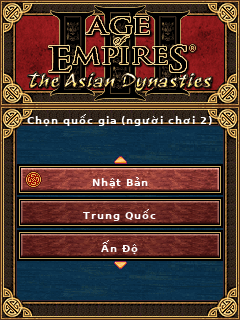
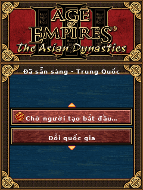
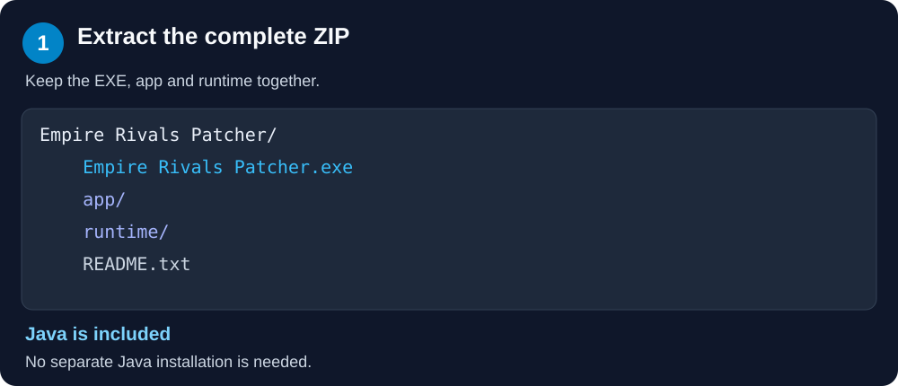
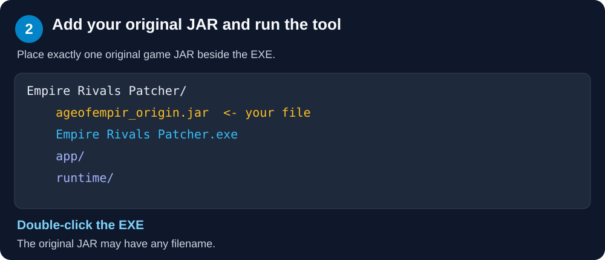
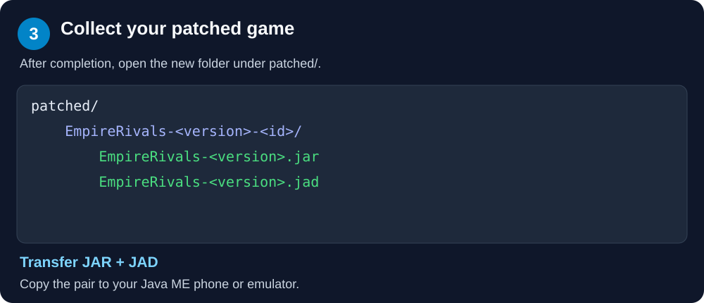

# Empire Rivals — Patch Tool

[Tiếng Việt](README.md) | [English](README.en.md)

**Tool patch dành cho Empire Rivals, phát triển bởi NvCUTU.**

Repository này dùng để phát hành tool patch, hướng dẫn sử dụng và ghi chú cập nhật. Không cung cấp JAR game gốc hoặc JAR game đã patch hoàn chỉnh. Người dùng tự cung cấp bản game gốc phù hợp; tool tạo bản đã patch ngay trên máy tính của người dùng.

**Game gốc cần có: Age of Empires III: The Asian Dynasties, phiên bản Java ME cho điện thoại.** Sử dụng JAR gốc chưa chỉnh sửa; bản PC không được hỗ trợ.

## Các thay đổi trong bản patch

- Bổ sung tiếng Việt và font có dấu.
- Hỗ trợ giao diện thích ứng nhiều kích thước màn hình.
- Bổ sung chế độ multiplayer qua Bluetooth.
- Hỗ trợ 8 ngôn ngữ: Vietnamese, English, German, Spanish, French, Italian, Portuguese và Portuguese (Brazil).
- Điều chỉnh khả năng tương thích Java ME, hướng tới CLDC 1.0 / MIDP 2.0.

Khả năng hoạt động của game và Bluetooth có thể khác nhau tùy điện thoại hoặc trình giả lập; vui lòng xem ghi chú của từng bản phát hành.

## Hình ảnh demo

Ảnh giao diện thực tế được chụp từ giả lập ở độ phân giải 240 × 320. Trạng thái phòng chờ được dựng sẵn để minh họa, không phải ảnh kiểm thử kết nối giữa hai điện thoại.

| Menu Bluetooth | Phòng chờ của người tạo |
| --- | --- |
|  |  |

| Chọn quốc gia | Chờ bắt đầu trận |
| --- | --- |
|  |  |

## Tải tool

Mở mục **Releases** của repository và tải:

- `EmpireRivals-Patcher-<version>-windows-x64.zip`
- File `.sha256` tương ứng nếu muốn kiểm tra tính toàn vẹn của bản tải xuống.

Không cần tải các gói **Source code (zip)** hoặc **Source code (tar.gz)** do GitHub tự tạo để sử dụng tool.

## Yêu cầu

- Máy tính **Windows 64-bit**.
- Một thư mục đã giải nén mà bạn có quyền ghi dữ liệu.
- JAR gốc chưa chỉnh sửa của **Age of Empires III: The Asian Dynasties (Java ME)**, đúng phiên bản tool hỗ trợ và bạn có quyền sử dụng hợp pháp.

**Không cần cài Java.** Tool đã kèm Java runtime và không cần Internet để thực hiện patch.

Tool chạy trên máy tính Windows; JAR/JAD được tạo ra dành cho thiết bị hoặc trình giả lập Java ME tương thích.

## Cách sử dụng

1. Giải nén **toàn bộ** ZIP vào một thư mục riêng.
2. Đặt **duy nhất một JAR game gốc Age of Empires III: The Asian Dynasties (Java ME)** cạnh `Empire Rivals Patcher.exe`.
3. Giữ nguyên hai thư mục `app` và `runtime` đi kèm.
4. Nhấp đúp `Empire Rivals Patcher.exe` và chờ thông báo hoàn tất.
5. Lấy file `.jar` và `.jad` trong thư mục con mới được tạo dưới `patched`.
6. Chuyển chúng sang điện thoại hoặc trình giả lập để cài đặt và chạy.

### Hướng dẫn bằng hình ảnh

Các hình dưới đây minh họa vị trí file và thao tác, không phải ảnh chụp File Explorer.

**Bước 1 — Giải nén toàn bộ ZIP**, giữ EXE cùng hai thư mục `app` và `runtime`.



**Bước 2 — Đặt JAR gốc cạnh EXE**, sau đó nhấp đúp `Empire Rivals Patcher.exe`.



**Bước 3 — Mở thư mục `patched`**, lấy cặp JAR/JAD mới và chuyển sang điện thoại hoặc trình giả lập Java ME.



Ví dụ thư mục trước khi patch:

```text
Empire Rivals Patcher/
├── Empire Rivals Patcher.exe
├── ageofempir_origin.jar       ← người dùng tự cung cấp
├── README.txt
├── app/
└── runtime/
```

Sau khi thành công, kết quả có dạng:

```text
patched/
└── EmpireRivals-<version>-<id>/
    ├── EmpireRivals-<version>.jar
    └── EmpireRivals-<version>.jad
```

Tên file JAR gốc có thể khác ví dụ trên, miễn có đuôi `.jar`. Mỗi lần chạy tạo một thư mục kết quả mới, không ghi đè JAR gốc.

## JAR gốc được hỗ trợ

Sử dụng JAR gốc **Age of Empires III: The Asian Dynasties (Java ME)** chưa chỉnh sửa. Tool không yêu cầu mã SHA-256 cố định cho JAR đầu vào. Việc tạo được bản patch không bảo đảm mọi biến thể tài nguyên đều tương thích.

Nên dùng bản gốc thay vì JAR đã Việt hóa hoặc đã patch để tránh lỗi tài nguyên. Repository này không cung cấp bản game gốc hay đường dẫn tải bản game đó.

## Cập nhật lên bản mới

1. Tải ZIP của bản mới trong **Releases**.
2. Giải nén vào một thư mục mới, không chép đè từng file vào tool cũ.
3. Đặt lại **JAR game gốc chưa chỉnh sửa** cạnh EXE.
4. Chạy tool và sử dụng JAR/JAD mới được tạo.

Không dùng JAR đã patch của phiên bản trước làm đầu vào. Đọc ghi chú phát hành trước khi thay bản game trên điện thoại; khả năng giữ dữ liệu lưu phụ thuộc vào phiên bản và thiết bị.

## Xử lý lỗi thường gặp

| Hiện tượng | Cách xử lý |
| --- | --- |
| Không tìm thấy JAR gốc hoặc có nhiều JAR | Đặt đúng một JAR gốc cạnh EXE, không đặt trong `app` hoặc `runtime`. |
| Không đọc được JAR đầu vào | Kiểm tra file có phải JAR hợp lệ, không bị hỏng; dùng JAR game gốc chưa chỉnh sửa. |
| Tool không chạy sau khi chỉ chép EXE | Giải nén lại toàn bộ ZIP và giữ `app`, `runtime` cạnh EXE. |
| Không ghi được kết quả | Chuyển toàn bộ thư mục tool sang vị trí bạn có quyền ghi, rồi thử lại. |
| Đã patch được nhưng game lỗi trên điện thoại | Báo lỗi kèm model máy, phiên bản patch, cách cài JAR/JAD và bước tái hiện. |

Để kiểm tra ZIP tải xuống, dùng `Get-FileHash` với file ZIP và so sánh kết quả với nội dung file `.sha256` của cùng bản phát hành.

## Báo lỗi

Mở **Issue** trong repository và cung cấp:

- Phiên bản tool patch.
- Model điện thoại hoặc tên và phiên bản trình giả lập.
- Ngôn ngữ game, độ phân giải và các bước gây lỗi.
- Thông báo lỗi hoặc ảnh chụp nếu có.

Vui lòng không đính kèm JAR game gốc hoặc JAR game đã patch vào issue.

## Cộng đồng và ủng hộ

- **Discord:** [Tham gia cộng đồng Empire Rivals](https://discord.gg/wfcXRDsqqq) để trao đổi, góp ý và nhận hỗ trợ.
- **Ko-fi:** [Ủng hộ nhà phát triển](https://ko-fi.com/alcavic).

## Tài nguyên và quyền sở hữu

Empire Rivals là dự án patch độc lập, không liên kết, không được tác giả hoặc nhà phát hành game gốc bảo trợ hay xác nhận.

Tool không đóng gói JAR game gốc hay các tài nguyên gốc được lấy từ JAR do người dùng cung cấp. Gói patch có mã thay thế và các phần bổ sung, bao gồm bản dịch và font tiếng Việt. Quyền đối với tài nguyên, nhãn hiệu và các thành phần của bên thứ ba thuộc về chủ sở hữu tương ứng; NvCUTU không tuyên bố sở hữu tài nguyên gốc.

Chỉ sử dụng tài nguyên mà bạn có quyền sử dụng hợp pháp. Việc có tool patch không cấp thêm quyền đối với tài nguyên bên thứ ba hoặc quyền phân phối lại bản game sau khi patch. Người dùng cần tuân thủ pháp luật và giấy phép áp dụng. Thông báo này không loại trừ trách nhiệm mà pháp luật không cho phép loại trừ.

Thông tin giấy phép của Java runtime đi kèm nằm trong `runtime/legal/` của gói tool. Repository này không cấp giấy phép chung cho các thành phần bên thứ ba.
